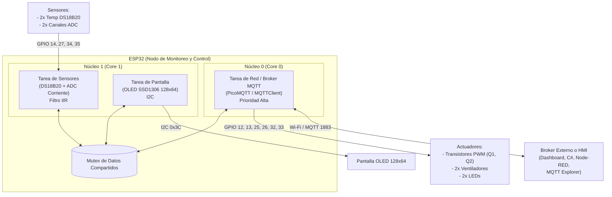

# 🌡️ Sistema de Monitoreo Térmico y Control con ESP32 y MQTT

[](https://www.espressif.com/en/products/socs/esp32)
[](https://mqtt.org/)
[](https://www.freertos.org/)
[](LICENSE)

Firmware modular para **ESP32** diseñado para la adquisición en tiempo real de temperatura (sensores digitales DS18B20), sensado de corriente (ADC) y control de potencia (modulación PWM en transistores, ventiladores y LEDs) a través del protocolo **MQTT** y comunicación **Serial**.

Incluye arquitecturas de **un solo núcleo** y **doble núcleo (FreeRTOS)**, con capacidades tanto para operar como **Cliente MQTT** como para alojar un **Broker MQTT local embebido** (`PicoMQTT`).

---

## 🗺️ Arquitectura del Sistema



---

## ⚡ Guía Rápida de Replicación (en 3 pasos)

Para clonar y poner a funcionar el proyecto en tu propio ESP32:

### Paso 1: Clonar o descargar el repositorio
```bash
git clone https://github.com/tu-usuario/CodigoEsp32Mqtt.git
cd CodigoEsp32Mqtt
```

### Paso 2: Crear tu archivo de configuración `data.h`
El archivo `data.h` contiene contraseñas privadas, por lo que **no se sube al repositorio** (está protegido por `.gitignore`). En su lugar, encontrarás plantillas listas llamadas `data.h.example`.

Copia el archivo de ejemplo para crear tu propio `data.h`:

* **En Linux / macOS / Git Bash:**
  ```bash
  # En la carpeta del sketch que vayas a usar, por ejemplo:
  cp Broker/ESP32BrokerDobleNucleo/data.h.example Broker/ESP32BrokerDobleNucleo/data.h
  # o si usas el cliente:
  cp Client/Esp32ClientMQTTDobleNucleo/data.h.example Client/Esp32ClientMQTTDobleNucleo/data.h
  ```
* **En Windows (CMD o PowerShell):**
  ```powershell
  # Ejemplo para el Broker Doble Núcleo:
  Copy-Item Broker\ESP32BrokerDobleNucleo\data.h.example Broker\ESP32BrokerDobleNucleo\data.h
  # Ejemplo para el Cliente Doble Núcleo:
  Copy-Item Client\Esp32ClientMQTTDobleNucleo\data.h.example Client\Esp32ClientMQTTDobleNucleo\data.h
  ```
* **O desde el Explorador de Archivos:**  
  Simplemente copia el archivo `data.h.example` que está junto al sketch `.ino`, pégalo en esa misma carpeta y renómbralo como `data.h`.

### Paso 3: Configurar tus credenciales
Abre el nuevo `data.h` y coloca tus datos de Wi-Fi y Broker:

```cpp
// --- Credenciales de tu Red Wi-Fi ---
constexpr char SSID[] = "Mi_Red_WiFi";
constexpr char PASS[] = "Mi_Password_Secreto";

// --- Configuración de tu Broker MQTT ---
constexpr char BROKER_MQTT[]     = "192.168.1.50"; // IP de tu broker (si usas Cliente)
constexpr uint16_t PUERTO_MQTT   = 1883;
constexpr char USER_MQTT[]       = "";             // Opcional
constexpr char PASS_MQTT[]       = "";             // Opcional
constexpr char ESP_CLIENT_NAME[] = "esp32_planta";
```

¡Listo! Ya puedes abrir el sketch en Arduino IDE y cargarlo a tu placa.

---

## 📁 Estructura del Repositorio

El repositorio está clasificado según el modo de operación:

```
CodigoEsp32Mqtt/
├── data.h.example                      # 📄 Plantilla maestra de configuración
├── Broker/
│   ├── ESP32BrokerDobleNucleo/         # 🌟 [RECOMENDADO] Broker local embebido en FreeRTOS
│   └── ESP32BrokerUnNucleo/            # Broker local básico en un solo hilo
├── Client/
│   ├── Esp32ClientMQTTDobleNucleo/     # 🌟 [RECOMENDADO] Cliente conectándose a Broker externo
│   └── Esp32ClienteTest/               # Cliente MQTT básico de prueba
├── Serial/
│   ├── SerialComunicacionControlDobleNucleo/ # Control serie optimizado en FreeRTOS
│   ├── SerilaComunicacionControl/            # Control serie básico en ESP32
│   └── ArduinoSerialPlanta/                  # Emulador de planta para Arduino UNO
├── pruebaMQTT/                         # Pruebas con PubSubClient + Tarjeta SD + TLS
└── libraries/                          # Librerías listas para instalar
```

---

## 🎯 ¿Qué sketch debo elegir?

| Caso de uso | Sketch recomendado | ¿Por qué? |
|---|---|---|
| **No tengo un servidor/PC para Mosquitto** | [`Broker/ESP32BrokerDobleNucleo`](file:///d:/RepoGit/CodigoEsp32Mqtt/Broker/ESP32BrokerDobleNucleo/ESP32BrokerDobleNucleo.ino) | El propio ESP32 crea el Broker MQTT. Cualquier PC o app se conecta directamente a la IP del ESP32. |
| **Ya tengo Mosquitto / Raspberry Pi / Cloud** | [`Client/Esp32ClientMQTTDobleNucleo`](file:///d:/RepoGit/CodigoEsp32Mqtt/Client/Esp32ClientMQTTDobleNucleo/Esp32ClientMQTTDobleNucleo.ino) | Conecta el ESP32 a la red corporativa o local como cliente estándar. Muy ligero y estable. |
| **Control cableado USB sin Wi-Fi** | [`Serial/SerialComunicacionControlDobleNucleo`](file:///d:/RepoGit/CodigoEsp32Mqtt/Serial/SerialComunicacionControlDobleNucleo/SerilaComunicacionControlDobleNucleo.ino) | Comunicación por comandos ASCII mediante cable USB a 115200 baudios. |
| **Tengo credenciales en tarjeta MicroSD** | [`pruebaMQTT`](file:///d:/RepoGit/CodigoEsp32Mqtt/pruebaMQTT/pruebaMQTT.ino) | Lee configuración de red y certificados TLS desde archivos de texto en la SD. |

---

## 🔌 Conexiones de Hardware (Pinout)

### Pines del ESP32

| Módulo / Periférico | Pin GPIO | Modo | Notas |
|---|---|---|---|
| **Sensor Temperatura 1** | `GPIO 14` | Digital (1-Wire) | DS18B20 (Requiere resistencia pull-up de 4.7 kΩ a 3.3V) |
| **Sensor Temperatura 2** | `GPIO 27` | Digital (1-Wire) | DS18B20 (Requiere resistencia pull-up de 4.7 kΩ a 3.3V) |
| **Sensor Corriente Q1** | `GPIO 35` | ADC (Analógico) | Entrada solo lectura (0 a 3.3V, resolución 12 bits) |
| **Sensor Corriente Q2** | `GPIO 34` | ADC (Analógico) | Entrada solo lectura (0 a 3.3V, resolución 12 bits) |
| **Transistor Potencia Q1** | `GPIO 13` | Salida PWM | Frecuencia: 500 Hz, Resolución: 8 bits (0-255) |
| **Transistor Potencia Q2** | `GPIO 12` | Salida PWM | Frecuencia: 10 kHz, Resolución: 8 bits (0-255) |
| **Ventilador 1** | `GPIO 33` | Salida PWM | Frecuencia: 5 Hz (control de pulso suave) |
| **Ventilador 2** | `GPIO 32` | Salida PWM | Frecuencia: 5 Hz (control de pulso suave) |
| **LED Indicador 1** | `GPIO 26` | Salida Digital | Indicador visual de estado |
| **LED Indicador 2** | `GPIO 25` | Salida Digital | Indicador visual de estado |
| **Pantalla OLED SSD1306** | `GPIO 21 (SDA)`<br>`GPIO 22 (SCL)` | Bus I2C | Dirección I2C: `0x3C`, resolución 128x64 px |

> [!IMPORTANT]
> **Resistencias de Pull-Up:** Los sensores de temperatura DS18B20 utilizan el protocolo Dallas 1-Wire. Es indispensable conectar una resistencia pull-up de **4.7 kΩ** entre el pin de señal de datos y el riel de **3.3V**.

---

## 📡 Protocolo MQTT — Tópicos y Comandos

### 📤 Tópicos de Telemetría (El ESP32 publica)
Frecuencia de envío: cada 500 ms a 1000 ms.

| Tópico | Tipo de Dato | Ejemplo | Descripción |
|---|---|---|---|
| `test/sensor/temperatura1` | `float` | `24.5` | Temperatura medida en sensor 1 (°C) |
| `test/sensor/temperatura2` | `float` | `31.2` | Temperatura medida en sensor 2 (°C) |
| `test/sensor/corrienteQ1` | `float` | `0.45` | Corriente calculada y filtrada en Q1 (A) |
| `test/sensor/corrienteQ2` | `float` | `0.82` | Corriente calculada y filtrada en Q2 (A) |
| `test/sensor/tiempo` | `uint32` | `120` | Tiempo de funcionamiento en segundos |

### 📥 Tópicos de Control (El ESP32 se suscribe)

| Tópico | Rango / Valores | Acción en Hardware |
|---|---|---|
| `test/datos/pwm1` | `0` a `100` (%) | Ajusta ciclo útil del Transistor Q1 (`GPIO 13`) |
| `test/datos/pwm2` | `0` a `100` (%) | Ajusta ciclo útil del Transistor Q2 (`GPIO 12`) |
| `test/datos/led1` | `"on"` / `"off"` | Enciende o apaga el LED 1 (`GPIO 26`) |
| `test/datos/led2` | `"on"` / `"off"` | Enciende o apaga el LED 2 (`GPIO 25`) |
| `test/datos/ventilador1`| `"on"` / `"off"` o `0-100` | Control de velocidad Ventilador 1 (`GPIO 33`) |
| `test/datos/ventilador2`| `"on"` / `"off"` o `0-100` | Control de velocidad Ventilador 2 (`GPIO 32`) |

---

## 📈 Filtro Digital IIR Implementado

Para suprimir el ruido eléctrico del ADC y las fluctuaciones térmicas, las lecturas se procesan mediante un filtro pasa-bajas exponencial de primer orden en tiempo discreto:

$$y[k] = \alpha \cdot x[k] + (1 - \alpha) \cdot y[k-1]$$

* **Temperatura ($\alpha = 0.8$):** Pondera fuertemente el nuevo valor asegurando respuesta rápida a los cambios térmicos reales.
* **Corriente ADC ($\alpha = 0.05$ - $0.1$):** Filtra fuertemente el ruido de alta frecuencia proveniente de la conmutación PWM y fuentes de alimentación.

---

## 📦 Librerías Necesarias

Las librerías están incluidas en la carpeta [`libraries/`](file:///d:/RepoGit/CodigoEsp32Mqtt/libraries/) de este repositorio, o pueden descargarse desde el gestor de librerías del Arduino IDE:

* **PicoMQTT** (de *Mculib*): Broker y cliente MQTT ultraligero para microcontroladores.
* **MQTT** (de *Joel Gaehwiler*): Cliente MQTT estándar utilizado en la versión Cliente.
* **PubSubClient** (de *Nick O'Leary*): Utilizado en el sketch de prueba con SD.
* **DallasTemperature** & **OneWire**: Control y lectura digital de los sensores DS18B20.
* **Adafruit SSD1306** & **Adafruit GFX Library**: Renderizado de gráficos y texto en el display OLED.

---

## 🛠️ Preguntas Frecuentes y Solución de Problemas

### 1. Error de compilación: `data.h: No such file or directory`
> **Causa:** No creaste el archivo `data.h`.  
> **Solución:** Copia el archivo `data.h.example` ubicado en la carpeta del sketch y renómbralo exactamente como `data.h`.

### 2. El sensor de temperatura reporta `-127.0 °C`
> **Causa:** El ESP32 no detecta el sensor DS18B20 en el bus 1-Wire.  
> **Solución:** Revisa la conexión de alimentación del sensor (GND y VCC a 3.3V) y verifica que la **resistencia pull-up de 4.7 kΩ** esté correctamente instalada entre el pin de datos y 3.3V.

### 3. La pantalla OLED no enciende o no muestra información
> **Causa:** Fallo en la comunicación I2C o dirección incorrecta.  
> **Solución:** Confirma que SDA esté en GPIO 21 y SCL en GPIO 22. Si tu pantalla usa la dirección `0x3D` en vez de `0x3C`, modifica en el código:
> ```cpp
> display.begin(SSD1306_SWITCHCAPVCC, 0x3D);
> ```

### 4. Al resetear el ESP32 (modo Broker), mi aplicación de C# o Dashboard se bloquea
> **Causa:** En los sketches de la carpeta `Broker/`, el ESP32 **es el servidor principal**. Si se reinicia, el broker desaparece de la red y los clientes pierden la conexión inmediatamente.  
> **Solución:** En producción, si necesitas reseteos frecuentes del nodo de sensores, utiliza la versión [`Client/Esp32ClientMQTTDobleNucleo`](file:///d:/RepoGit/CodigoEsp32Mqtt/Client/Esp32ClientMQTTDobleNucleo/Esp32ClientMQTTDobleNucleo.ino) conectada a un broker externo persistente (como Mosquitto en Raspberry Pi o PC).

---

## 📄 Licencia

Este proyecto se distribuye bajo la licencia **MIT**. Consulta el archivo [LICENSE](file:///d:/RepoGit/CodigoEsp32Mqtt/LICENSE) para más detalles.
